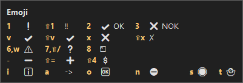
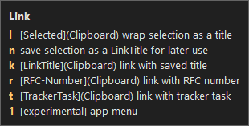
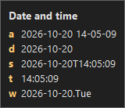

# AHK Assistant

AutoHotkey v2 toolkit for Windows: emoji and timestamp snippets,
Markdown / Jira link and code-block helpers, window placement and
app-specific key remaps. Everything runs from one resident script,
`Assistant.ahk`.

Most snippets are "combo, then key" menus: press a combo such as
Alt+Shift+E, and a small window lists the keys of the menu.





## Requirements

- Windows 10/11
- [AutoHotkey](https://www.autohotkey.com/) **v2.0+**
- Optional, used by some hotkeys: VirtuaWin, foobar2000, Firefox,
  MobaXterm, Outlook, Burp Suite, Adventure IDE, Jira / Confluence.

## Install

1. Install AutoHotkey v2.
2. Download this repository (Code → Download ZIP) and unpack it, or
   clone it with git.
3. Run `Assistant.ahk` (double-click; the AutoHotkey launcher picks v2
   from its `#Requires` line), or
   `"C:\Program Files\AutoHotkey\v2\AutoHotkey64.exe" Assistant.ahk`.
4. Optional: to start it with Windows, put a shortcut to it into
   `shell:startup`.

## Usage

- After editing a script or `config.ahk`, reload with **Ctrl+Alt+R**.
- Syntax check without running (exit code 0 = OK):
  `AutoHotkey64.exe /ErrorStdOut /validate Assistant.ahk`
- Russian abbreviations (`lib/hotstrings.ahk`) are off by default: turn
  them on with `MODULES["hotstrings"] := true` in `config.ahk`. An
  abbreviation expands only after Space, Enter or Tab.

## Configuration

Settings live in `config.default.ahk` (tracked; don't edit it). To change
one, create `config.ahk` next to it (not tracked, optional) and assign
only that value; it is included after the defaults, so it wins. Reload
with Ctrl+Alt+R.

| Setting | Default | Meaning |
|---|---|---|
| `DEBUG` | `false` | Diagnostic tooltips |
| `DELAY` | `50` | ms between sent keys |
| `HINTS` | `true` | Window with the keys of a "combo, then key" menu |
| `TRACKERS` | example Jira and YouTrack | Issue trackers for Alt+Shift+L, `t` |
| `MENU_KEYS` | the combos below | Combos that open the menus |
| `MODULES` | all on but `hotstrings` | Feature modules that are on |
| `WINDOW_STEPS` | `[2/3, 1/2, 1/3]` | Sizes that Ctrl+Win+arrows step through |
| `MOUSE_KEYS` | XButton1, Ctrl+Alt+M | Slow mouse hotkeys: hold, toggle |
| `MOUSE_SLOW_SPEED` | `1` | Slow mouse speed, 1 (slowest) to 20 |

`MODULES` turns each module of `lib/` on (`true`) or off (`false`):
`emoji`, `datetime`, `markup` (link and code menus), `hotkeys` (global
remaps), `apps`, `window`, `diag`, `mouse` and `hotstrings` (Russian
abbreviations, off by default). An off module's keys reach the active
app as if the module weren't there. Ctrl+Alt+R (reload) always works.
Change one in `config.ahk`:

```ahk
MODULES["hotstrings"] := true
MODULES["mouse"] := false
```

`MENU_KEYS` maps each menu (`emoji`, `datetime`, `link`, `code`,
`codeblock`, `info`) to its combo, written as modifiers (Ctrl, Alt,
Shift, Win) and a key joined with `+`; `""` turns a menu off. Change one
in `config.ahk`:

```ahk
MENU_KEYS["emoji"] := "Ctrl+Alt+E"
```

A letter, digit or punctuation key needs Ctrl, Alt or Win. A bad combo,
or one that another menu already uses, is reported in a message at
startup, and the menu keeps its default. The same message lists
`MODULES` mistakes (an unknown name, a value other than `true` or
`false`).

`MOUSE_KEYS` holds the slow mouse hotkeys, written the same way: `hold`
(slow while its key is held, XButton1: the back side button of the
mouse) and `toggle` (Ctrl+Alt+M). A mouse button needs no modifier.
While XButton1 is the hold key, it no longer works as Back in browsers;
pick another combo, or `""` to turn hold mode off. `MOUSE_SLOW_SPEED` is
the slow speed (1-20; the normal speed is your Windows setting). Example
`config.ahk`:

```ahk
MOUSE_KEYS["hold"] := "XButton2"
MOUSE_KEYS["toggle"] := "Ctrl+Alt+N"
MOUSE_SLOW_SPEED := 4
```

A mistake in them is reported in the same startup message.

`TRACKERS` is a `Map` of trackers; each has a `host` and a `path`
(regular expressions). Example `config.ahk`:

```ahk
TRACKERS := Map(
    "jira", Map("host", "jira\.example\.com", "path", "/browse/"),
    "youtrack", Map("host", "yt\.example\.com", "path", "/issue/")
)
```

## Hotkeys

**Menus:** "Alt+Shift+T → d" means press Alt+Shift+T, release, then
press d. A small window lists the menu's keys until you press one (any
key closes the menu, a key outside the menu does nothing). Set `HINTS :=
false` in `config.ahk` to turn the window off. Menu keys are physical
keys, so they work in any keyboard layout. The combos that open the
menus are defaults; `MENU_KEYS` changes them (see Configuration).

### Global

| Hotkey | Action |
|---|---|
| Wheel over taskbar | Volume up / down |
| NumpadDot | Always types `.` |
| Win+Shift+K | Bluetooth panel |
| XButton1 (mouse side button, hold) | Slow mouse while held (`MOUSE_KEYS`) |
| Ctrl+Alt+M | Toggle slow mouse (`MOUSE_KEYS`) |
| Browser_Home | Monitor info |
| Browser_Favorites | Live window info tooltip |
| Esc | Stops the live info tooltip |

### Per application

Apps and services are recognised by the rules in `AppRules()` and
`ServiceRules()` in `lib/tools.ahk`. A browser tab counts as both its
browser and its service: the Firefox keys also work on Confluence.
Services are found by the page title in any browser (Brave, Chrome,
Edge, Firefox, Opera, Vivaldi): the browser's name at the end of the
window title is ignored.

- **Adventure IDE, Burp Suite, Confluence:** Ctrl+Ins / Shift+Ins /
  Shift+Del work as copy / paste / cut.
- **foobar2000** (any window): Win+Alt+B sends Win+Alt+Shift+B, the
  player's own global hotkey.
- **Mattermost:** Ctrl+Enter sends the message; Enter adds a new line.
- **MobaXterm:** Shift+Ins pastes; in PuTTY-style terminal windows
  Ctrl+V and Shift+Ins paste via middle click.
- **Outlook:** Ctrl+F searches inside the message body.
- **VirtuaWin** (any window): Ctrl+Win+1…5 moves the window to desktop
  1–5 (sends Ctrl+Win+Alt+1…5).

### Alt+Shift+E → emoji

| Key | Inserts |
|---|---|
| `1` / `!` | ❗ / ‼️ |
| `2` / `3` | ✔️ OK / ❌ NOK |
| `v` / `V` | ✔️ / ✔ (plain) |
| `x` / `X` | ❌ / ✗ (plain) |
| `6` or `w` | ⚠️ |
| `7` or `?` | ❓ |
| `8` or `*` | \*️⃣ |
| `i` | ℹ️ |
| `o` | 🆗 |
| `n` | ⛔ |
| `s` | 🛑 |
| `t` | 🤷 |
| `$` | 💲 |
| `+` / `-` | ➕ / ➖ |
| `a` | `->` |

The letters also work in the Russian layout (`м` = `v`, `Ч` = `X`, …).

### Alt+Shift+T → timestamp

| Key | Example |
|---|---|
| `d` | `2026-10-14` |
| `a` | `2026-10-14 18-05-09` |
| `s` | `2026-10-14T18:05:09` |
| `t` | `18:05:09` |
| `w` | `2026-10-14.Wed` |

Any other key sends Alt+Shift+T on to the active app.

### Alt+Shift+L → Markdown or Jira link

Copy the URL first; select the link text if you have it. The link is
written as `[title](url)`, or as `[title|url]` when the active window is
Jira (picked by window title, like the code snippets below). Confluence
still gets the Markdown form. The table shows the Markdown form.

| Key | Result |
|---|---|
| `l` | `[selection](url)` |
| `n` | Remember selection as link title |
| `k` | `[remembered title](url)` |
| `t` | Tracker URL (see `TRACKERS`) → `[KEY-123](url)` |
| `r` | RFC URL → `[rfc9110#sect](url)` |
| `1` | Experimental, app-specific |

When nothing fits (no selection, or the URL doesn't match), you get
`[](url)` (`[|url]` in Jira) with the caret inside `[]`. Tracker hosts
are set in the `TRACKERS` map (see Configuration).

### Alt+` → inline code, Ctrl+Shift+` → code block

| Key | Result |
|---|---|
| `` ` `` | Wrap the selection, or insert an empty pair with the caret inside |
| `v` | Insert the clipboard, wrapped |

The markup depends on the active window title:

| Window | Inline | Block |
|---|---|---|
| Jira | `{{…}}` | `{code}…{code}` |
| Confluence | `{{…}}` | ```` ``` ```` → code block |
| Other | `` `…` `` | ```` ``` ```` fence |

### Ctrl+Alt+I → system info

| Key | Shows |
|---|---|
| `d` | DPI per monitor |
| `i` | Monitors: count, primary, active, geometry, DPI |
| `l` | System / user default language ID |
| `m` | Number of the monitor with the active window |
| `n` | User default locale name |
| `t` | Current weekday |
| `w` | Live info for the window under the cursor (Esc stops) |

### Windows

| Hotkey | Action |
|---|---|
| Ctrl+Win+←/→/↑/↓ | Fill the left/right/top/bottom 2/3 of the monitor; press again for 1/2, then 1/3, then 2/3 again (`WINDOW_STEPS`) |
| Win+↑ | Maximize |
| Win+↓ | Restore if maximized, else minimize |
| Ctrl+Win+Numpad8/2/4/6 | Fill the top/bottom/left/right half |
| Ctrl+Win+Numpad7/9/1/3 | Fill the matching quarter |
| Ctrl+Win+Numpad5 | Maximize, or restore if maximized |
| Launch_App1 | Toggle "always on top" |

Ctrl+Win+←/→ replace Windows' virtual desktop switching. The numpad
keys need NumLock on.

Ctrl+Win+arrows step through the sizes in `WINDOW_STEPS` (part of the
monitor's width for ←/→, of its height for ↑/↓; the other side stays
full). A press is the next step only for the same window and arrow,
with the window not moved or resized since; anything else starts at
the first size. Change the sizes in `config.ahk`, e.g.
`WINDOW_STEPS := [3/4, 1/2, 1/4]`; a bad list is reported at startup
and the default is used.

### Script

| Hotkey | Action |
|---|---|
| Ctrl+Alt+R | Reload (asks first) |
| Ctrl+Alt+Shift+R | Hide a stuck tooltip |

## Repository layout

```text
Assistant.ahk         main script, entry point
config.default.ahk    default settings (tracked)
config.ahk            your settings (optional, not tracked)
lib/                  modules
  tools.ahk           shared helpers (keys, menus, modules,
                      clipboard, monitors, app/service detection)
  script.ahk          reload, hide a tooltip (always on)
  snippets-*.ahk      emoji, timestamp and markup menus
  hotkeys.ahk         global remaps
  apps.ahk            app-specific remaps
  window.ahk          window placement, always on top
  diag.ahk            window/monitor/DPI/locale info
  mouse.ahk           mouse precision mode
  hotstrings.ahk      Russian abbreviations (off by default)
tests/                unit, module-guard, window-size and README checks
docs/                 screenshots
.claude/              Claude Code: validate-on-edit hook
.ai/                  AI-assisted work: plans and decision log
AGENTS.md             guidance for coding agents
```

## Editors

* [VS Code](https://code.visualstudio.com/) with
  [AHK++](https://marketplace.visualstudio.com/items?itemName=mark-wiemer.vscode-autohotkey-plus-plus)
* [Adventure IDE](https://sourceforge.net/projects/autogui/)
* [AHK Studio](https://www.autohotkey.com/boards/viewtopic.php?f=62&t=300)
* [SciTE4AutoHotkey](https://www.autohotkey.com/boards/viewtopic.php?t=62)

## License

[MIT](LICENSE)
